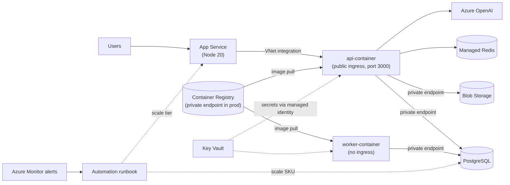

# Proactive Infrastructure

Terraform for the Azure platform behind the Proactive application. One root module creates a resource group and calls nine local child modules: networking, security, storage, database, AI, backend, frontend, Redis and scaling.

Each environment (`dev`, `staging`, `prod`) is the same code deployed with its own variable file and its own state file.

## What gets deployed

| Area | Azure resources |
|---|---|
| Networking | VNet, 3 subnets (frontend, backend, private endpoints) and 1 NSG. No VPN gateway |
| Security | Key Vault (RBAC mode), 2 user-assigned managed identities, role assignments |
| Storage | Storage account (public access off), private endpoint, private DNS zone |
| Database | PostgreSQL Flexible Server 16. Optional private endpoint, a switch for public access (with an office-IP firewall rule while it is on), storage auto-grow and alert-driven SKU scaling |
| AI | Azure OpenAI account with `gpt-5` and `gpt-4o` deployments side by side (East US) |
| Backend | Container Apps environment, `api-container` and `worker-container`, one shared Container Registry (optionally Premium with a private endpoint), Log Analytics |
| Frontend | Linux App Service plan and Web App (Node 20 LTS). Optional instance autoscale and alert-driven tier scaling |
| Scaling | Automation account and runbook, Azure Monitor alerts and action groups, App Service autoscale (off unless enabled) |
| Cache | Azure Managed Redis (East US) |



## Repository layout

```text
proactive-infra/
├── main.tf              # resource group, module wiring, app secrets
├── outputs.tf           # registry, app FQDNs, DB server name
├── providers.tf         # Terraform/provider versions, remote state backend
├── variables.tf         # root input variables
├── config/
│   ├── dev.tfvars
│   ├── staging.tfvars
│   ├── prod.tfvars
│   ├── backend-dev.hcl      # state key per environment
│   ├── backend-staging.hcl
│   └── backend-prod.hcl
├── modules/
│   ├── networking/  security/  storage/  database/
│   └── ai/  backend/  frontend/  redis/  scaling/
└── .azuredevops/        # pipeline files (currently empty)
```

## Prerequisites

- Terraform `>= 1.5.0` and the Azure CLI
- An Azure subscription where you can create resources **and** role assignments (Owner, or Contributor plus User Access Administrator)
- Access to the remote state storage account defined in `providers.tf`

Providers: `azurerm ~> 4.0`. The `random` provider is declared but not currently used.

## Deploying

```powershell
az login
az account set --subscription "<subscription id or name>"

# The DB password is never stored in files. Set it per session:
$env:TF_VAR_administrator_password = "<strong password>"

# Point at this environment's state file, then plan/apply with its variables
terraform init -reconfigure -backend-config="config/backend-dev.hcl"
terraform plan  -var-file="config/dev.tfvars" -input=false
terraform apply -var-file="config/dev.tfvars"
```

For staging or prod, replace `dev` with `staging` or `prod` in **both** the `init` and the `plan`/`apply` commands. Always re-run `init -reconfigure` when you switch environments, otherwise Terraform reads the wrong state.

Files in `config/` are not loaded automatically. Without `-var-file`, Terraform prompts for every variable that has no default.

**State backend authentication.** Either set `ARM_ACCESS_KEY` to the storage account key (the raw key only, not a connection string), or sign in with `az login` as a user allowed to read the account keys. Never put the key in `providers.tf`.

### State files

| Environment | State key | Config |
|---|---|---|
| dev | `terraform.tfstate` | `backend-dev.hcl` |
| staging | `staging.tfstate` | `backend-staging.hcl` |
| prod | `prod.tfstate` | `backend-prod.hcl` |

Dev keeps the original key so existing state is preserved.

## Environments

| Variable | dev | staging | prod |
|---|---|---|---|
| `environment` | `dev` | `stg` | `prod` |
| `vnet_address_space` | 10.0.0.0/16 | 10.1.0.0/16 | 10.2.0.0/16 |
| `webapp_sku` | B1 | S1 | P1v3 |
| `db_sku` | B_Standard_B1ms | B_Standard_B2s | B_Standard_B2s (start of ladder) |
| `redis_sku` | Balanced_B0 | Balanced_B0 | Balanced_B1 |
| Container apps | 2 (default sizes) | 2 (default sizes) | 2 (api 1 vCPU, 2-10 replicas; worker 1 vCPU, 1-5) |
| Registry | Basic, public | Basic, public | Premium, private endpoint |
| DB / web scaling | off | off | on (see Production) |
| Database network | public + office IP | public + office IP | private endpoint, public still on (see Production) |
| OpenAI deployments | gpt-5 + gpt-4o | gpt-5 + gpt-4o | gpt-5 + gpt-4o |

The staging file is `staging.tfvars` but its `environment` value is `stg`, so staging resources are named `...-stg`.

## Input variables

| Variable | Type | Default | Notes |
|---|---|---|---|
| `environment` | string | none (required) | Used in every resource name |
| `prefix` | string | `proact` | Lowercase letters and digits. Keep `prefix` + `environment` at 16 characters or fewer (Key Vault and storage account name limits) |
| `location` | string | `uksouth` | Azure region name. Redis and OpenAI are pinned to `eastus` in their modules |
| `vnet_address_space` | list(string) | none (required) | Use a /16. Subnets are carved from the first entry with `cidrsubnet` |
| `webapp_sku` | string | none (required) | App Service plan SKU |
| `db_sku` | string | none (required) | Must include the tier prefix, e.g. `B_Standard_B1ms` |
| `redis_sku` | string | `Basic` | The default is not a valid Managed Redis SKU. Always set it, e.g. `Balanced_B0` (case-sensitive) |
| `redis_capacity` | number | `0` | Unused placeholder |
| `administrator_password` | string, sensitive | none (required) | Set via `TF_VAR_administrator_password` |
| `office_ip` | string | `135.129.124.220` | Single IP allowed through the database firewall. Only used while public access is on |
| `app_secrets` | map(string), sensitive | `{}` | Written to Key Vault as secrets |
| `app_secrets_kv_uris` | map(string) | `{}` | Extra Key Vault secret URIs exposed to the backend |
| `container_apps` | map(object) | `api-container` + `worker-container` | Per app: `ingress_enabled`, `external_ingress`, `target_port`, `image`, `cpu`, `memory`, `min_replicas`, `max_replicas`, `http_concurrent_requests` |
| `acr_private_link_enabled` | bool | `false` | Premium registry reached over a private endpoint |
| `acr_allowed_ip_ranges` | list(string) | `[]` | CIDRs allowed to push to the registry when private link is on |
| `db_storage_mb` | number | `32768` | Initial database storage |
| `db_private_endpoint_enabled` | bool | `false` | Create the database private endpoint and private DNS so VNet workloads connect over a private IP |
| `db_public_access_enabled` | bool | `true` | Keep the database's public endpoint on. Can only be `false` when the private endpoint is enabled |
| `ai_deployments` | map(object) | `gpt-5` + `gpt-4o` | Deployments keyed by name. Per entry: `model_name`, `model_version`, `sku` (default `GlobalStandard`), `capacity` (default 10, thousands of tokens per minute) |
| `db_scaling` | object | disabled | Storage auto-grow and alert-driven SKU ladder (see Production) |
| `webapp_scaling` | object | disabled | Instance autoscale and alert-driven tier ladder (see Production) |

## Modules

### Networking
- VNet `vnet-<prefix>-<env>` with three subnets, for a `10.0.0.0/16` space:

| Subnet | Range | Purpose |
|---|---|---|
| `snet-frontend` | 10.0.1.0/24 | App Service VNet integration (delegated to `Microsoft.Web/serverFarms`) |
| `snet-backend` | 10.0.2.0/23 | Container Apps environment (delegated to `Microsoft.App/environments`) |
| `snet-pe` | 10.0.5.0/24 | Private endpoints (database, storage, registry) |

- `nsg-backend-<env>` allows inbound 443 from the frontend subnet.
- There is no VPN gateway and no database subnet. The database is reached through a private endpoint in `snet-pe`, not by VNet injection.

### Security
- Key Vault `kv-<prefix>-<env>-sec` with RBAC authorization, 7-day soft delete, purge protection off, network default action `Allow`.
- User-assigned identities `<prefix>-id-frontend-<env>` and `<prefix>-id-backend-<env>`.
- Roles: the deploying identity gets *Key Vault Secrets Officer*; both app identities get *Key Vault Secrets User*.
- Outputs wait for their role assignments so secret writes don't race RBAC propagation.

### Storage
- Storage account `st<prefix><env>` (Standard LRS), public network access disabled, private container `app-data`.
- Private endpoint, `privatelink.blob.core.windows.net` DNS zone and VNet link.
- Backend identity gets *Storage Blob Data Contributor*. The connection string is stored as `STORAGE-CONNECTION-STRING`.

### Database
- PostgreSQL Flexible Server `psql-<prefix>-<env>`, version 16, size from `db_sku`, starting storage from `db_storage_mb`. The server is not VNet-injected.
- **Private endpoint** (`db_private_endpoint_enabled`): `pe-psql-<prefix>-<env>` in `snet-pe`, with a `privatelink.postgres.database.azure.com` DNS zone linked to the VNet. The normal server name then resolves to a private IP for everything inside the VNet, including `api-container` and `worker-container`, so they connect privately with no application change.
- **Public access** (`db_public_access_enabled`): on by default. While it is on, the firewall rule `allow-office-wifi` allows one `office_ip`. When you set it to `false`, Azure stops enforcing firewall rules and the rule is removed. It can only be turned off if the private endpoint is enabled; otherwise the plan fails.
- Admin login `psqladmin` with `administrator_password`. Password and Entra ID authentication are both enabled.
- Stores `DB-HOST` and `DB-CONNECTION-STRING` (password URL-encoded) in Key Vault.
- With `db_scaling.enabled`, the server is created with storage **auto-grow** and Terraform ignores `sku_name`, `storage_mb` and `tags`, so runtime scaling is not reverted.

### AI
- Cognitive account `cog-<prefix>-ai-<env>` (kind `OpenAI`, S0, East US, key auth disabled, public access on).
- One deployment per entry in `ai_deployments`. By default `gpt-5` (`2025-08-07`) and `gpt-4o` (`2024-11-20`), both `GlobalStandard` with capacity 10. Add or remove entries to change what is deployed. Each model has its own quota, so a deployment can fail if your subscription has no quota for that model.
- Backend identity gets *Cognitive Services OpenAI User*. The endpoint is stored as `AI-ENDPOINT`. Each deployment's name is stored as `AI-DEPLOYMENT-<NAME>` (`AI-DEPLOYMENT-GPT-5`, `AI-DEPLOYMENT-GPT-4O`), so applications read the name instead of hardcoding it.
- An existing single `gpt-5` deployment from the earlier layout is kept (state is moved to the new `gpt-5` entry).
- **gpt-4o is a legacy model.** Microsoft's retirement schedule lists version `2024-11-20` as Legacy with a retirement date of 14 April 2027, but dates have moved before, and a subscription with no existing gpt-4o deployment may be refused. Before applying, confirm both models can be created as `GlobalStandard` in East US (portal, or `az cognitiveservices model list --location eastus`) and check the current retirement dates.
- Azure can reject two deployments created at the same moment on one account with a conflict error. If that happens, run `terraform apply` again, or use `-parallelism=1` for the first apply.

### Backend
- Log Analytics `law-<prefix>-backend-<env>` (30 days), Container Apps environment `cae-<prefix>-<env>` in the backend subnet.
- One Container Registry `cr<prefix><env>` shared by every app. With `acr_private_link_enabled` it is **Premium**, has a private endpoint in `snet-pe`, a `privatelink.azurecr.io` DNS zone linked to the VNet, and the admin account off. Otherwise it is Basic with the admin account on. Apps pull with the backend identity (*AcrPull*), never with registry passwords.
- Two container apps from `var.container_apps`: `api-container` (external HTTPS ingress on port 3000, HTTP-concurrency replica scaling) and `worker-container` (no ingress). Both use the same identity, registry and Key Vault-backed secrets.
- **Images are placeholders** (`containerapps-helloworld`). Push your images to `<acr_login_server>/api-container` and `<acr_login_server>/worker-container` and deploy them from CI/CD. Terraform ignores image changes so it never rolls a deployment back. The placeholder listens on port 80, so the API will not answer on 3000 until the real image is deployed.
- Pushing to a private registry needs network access to it. There is no VPN, so use a build agent inside the VNet or add its address to `acr_allowed_ip_ranges` (the registry's public endpoint then stays closed to everyone else, and image pulls remain private).

### Frontend
- App Service plan `asp-<prefix>-<env>` using `webapp_sku` and Web App `app-<prefix>-frontend-<env>` (Node 20 LTS) with the frontend identity and VNet integration. `always_on` is on for every tier except F1/D1.
- With a `webapp_scaling.sku_ladder`, Terraform ignores the plan's `sku_name` so tier changes made by the runbook stay.

### Redis
- Azure Managed Redis `redis-<prefix>-<env>-832` in East US, using `redis_sku`. Access-key authentication on, `EnterpriseCluster` clustering, `NoEviction`.
- Stores `REDIS-HOST`, `REDIS-PORT` and `REDIS-PRIMARY-KEY`.

### Scaling
Active only when `db_scaling.enabled` or `webapp_scaling.enabled` is true.

```text
Azure Monitor metric alert -> Action Group -> Automation webhook -> runbook "Scale-Sku"
                                                                 -> ARM call: move ONE step on the SKU ladder
```

- Automation account `aa-<prefix>-scaling-<env>` with a system-assigned identity that has *Contributor* on the database server and the App Service plan only.
- Runbook `Scale-Sku` (`modules/scaling/scripts/Scale-Sku.ps1`) ignores "Resolved" alerts, skips when the resource is not `Ready`, enforces a cooldown (stored as a tag on the resource), moves exactly one step and never leaves the ladder.
- **Database alerts:** CPU above `scale_up_cpu_percent` for 15 min, or `cpu_credits_remaining` below `cpu_credits_low` (Burstable only): step up. CPU below `scale_down_cpu_percent` for 6 h: step down.
- **Web alerts:** CPU above `scale_up_cpu_percent` for 30 min or memory above 90% for 30 min: next tier. CPU below `scale_down_cpu_percent` for 12 h: previous tier.
- **Web autoscale (native):** adds or removes instances between `min_instances` and `max_instances` on CPU and memory. It needs a Standard or Premium plan.
- Webhooks expire on `webhook_expiry_time` (default 1 October 2036). Rotate them before then.

## Secrets flow

1. The database, AI, Redis and storage modules write their connection details into Key Vault.
2. `main.tf` builds the URI for each of those these secrets (`DB-HOST`, `DB-CONNECTION-STRING`, `AI-ENDPOINT`, one `AI-DEPLOYMENT-<NAME>` per AI deployment, `REDIS-HOST`, `REDIS-PORT`, `REDIS-PRIMARY-KEY`, `STORAGE-CONNECTION-STRING`) and merges them with `var.app_secrets_kv_uris`.
3. The Container App references each URI as a Key Vault-backed secret using the backend identity, and exposes it as an environment variable with the **same name as the key** (for example `DB-HOST`). The backend module `depends_on` the modules that create those secrets, so they exist first.

To create your own secrets, set `app_secrets` (write them to a git-ignored `secrets.auto.tfvars`):

```hcl
app_secrets = {
  "STRIPE-KEY" = "sk_live_..."
}
```

That writes them to Key Vault only. To also expose one to the backend, add its URI:

```hcl
app_secrets_kv_uris = {
  "STRIPE-KEY" = "https://kv-proact-dev-sec.vault.azure.net/secrets/STRIPE-KEY"
}
```

## Production

`config/prod.tfvars` enables the production behaviour.

| Capability | How it works | Limits to know |
|---|---|---|
| Two container apps, one private registry | `api-container` and `worker-container` pull from the same Premium registry over a private endpoint | Premium registry is billed daily. Pushing images needs network access (see Backend) |
| Database connection | Container apps reach the database through its private endpoint | Public access is still on in `prod.tfvars` until you turn it off (see below) |
| Database storage | Auto-grow, starting at 128 GB | Storage can only grow, never shrink |
| Database tier | Alert-driven ladder: `B_Standard_B2s`, `B2ms`, `B4ms`, `GP_Standard_D4s_v3`, `GP_Standard_D8s_v3` | Each change restarts the server (brief downtime). Metric alerts fire once and re-fire only after they resolve, so a very large jump takes several cycles |
| CPU credits | Burstable SKUs only. Low credits trigger a step up to a larger credit bank or to General Purpose (no credits) | You cannot buy credits. High availability is not available on Burstable SKUs |
| Web instances | Native autoscale, 2 to 6 instances | Standard tier or above |
| Web tier | Alert-driven ladder `P1v3`, `P2v3`, `P3v3` | Stay inside one family. Moves across families (for example Standard to Premium v3) can be refused by Azure |

After the first apply, **do not change `db_sku` or `webapp_sku` in tfvars to resize**. Those values only set the starting size. Change the ladder or run the resize from Azure instead.

### Closing public access to the production database

`prod.tfvars` creates the private endpoint and leaves public access on, with the office-IP firewall rule. When you are ready to close it:

1. Confirm the apps connect privately: the endpoint's connection state is `Approved`, and from inside a container the server name resolves to a `10.2.5.x` address.
2. Set `db_public_access_enabled = false` in `config/prod.tfvars` and apply.

Do not switch it off only in the portal. The next apply would turn it back on, because Terraform manages the setting. After it is off, the database is reachable only from inside the VNet.

**Reaching the database and registry without a VPN.** There is no gateway, so admin work, migrations and CI image pushes must come from inside the VNet (for example a self-hosted agent or a container app job). Break-glass options:

- Database: set `db_public_access_enabled = true` again and apply, with your current address in `office_ip`.
- Registry: add your build agent's address to `acr_allowed_ip_ranges`.

Switch both back off afterwards.

To enable scaling on an environment that already exists, move the state first, otherwise Terraform replaces the server or plan (see the comments in `modules/database/main.tf` and `modules/frontend/main.tf`).

Before the first prod apply:

```powershell
az provider register --namespace Microsoft.Automation
az provider register --namespace Microsoft.Insights
```

The action groups have no email or chat receivers. Add one if you want to be told when a scale event happens.

## Known limitations

These are fine for dev and should be reviewed before production:

- While `db_public_access_enabled` is true (dev, staging and prod today), the database is also reachable from the internet, protected only by the firewall rule and a password.
- The Container App has public ingress.
- The Key Vault allows all networks and has purge protection off.
- OpenAI has public network access enabled; OpenAI and Redis are pinned to East US regardless of `location`.
- Storage account keys and the ACR admin account are enabled.
- `nonsensitive()` is applied to `var.app_secrets` in `main.tf` so it can be used with `for_each`.
- After a destroy, a soft-deleted Key Vault name stays reserved. `recover_soft_deleted_key_vaults` re-adopts it on the next apply.
- Environment variable names contain hyphens (for example `DB-HOST`). Confirm your application can read them or add a name mapping.

## Troubleshooting

| Symptom | Cause and fix |
|---|---|
| Terraform prompts for `db_sku`, `administrator_password`, etc. | No `-var-file` was passed, or the password variable isn't set |
| `illegal base64 data at input byte 24` | `access_key` or `ARM_ACCESS_KEY` contains a connection string. Use only the key value |
| `config\backend-...hcl could not be read` | Run from the repo root and check the file exists in `config/` |
| Plan wants to destroy resources after switching environments | Missing `terraform init -reconfigure` with the right `-backend-config` |
| Plan fails with "Public access can only be disabled when private_endpoint_enabled is true" | Set `db_private_endpoint_enabled = true` before `db_public_access_enabled = false` |
| Apps cannot reach the database after public access is off | Check the private endpoint is `Approved`, the `privatelink.postgres.database.azure.com` zone is linked to the VNet, and the server name resolves to a `10.x.5.x` address |
| An AI deployment is refused or conflicts | The model or version may not be available to this subscription, region or quota. Check availability, change `ai_deployments`, or re-run apply if it was a conflict between simultaneous deployments |
| Container App creation fails on a secret | The Key Vault secret doesn't exist yet or RBAC hasn't propagated. Re-run apply |
# prodgradeterraform

